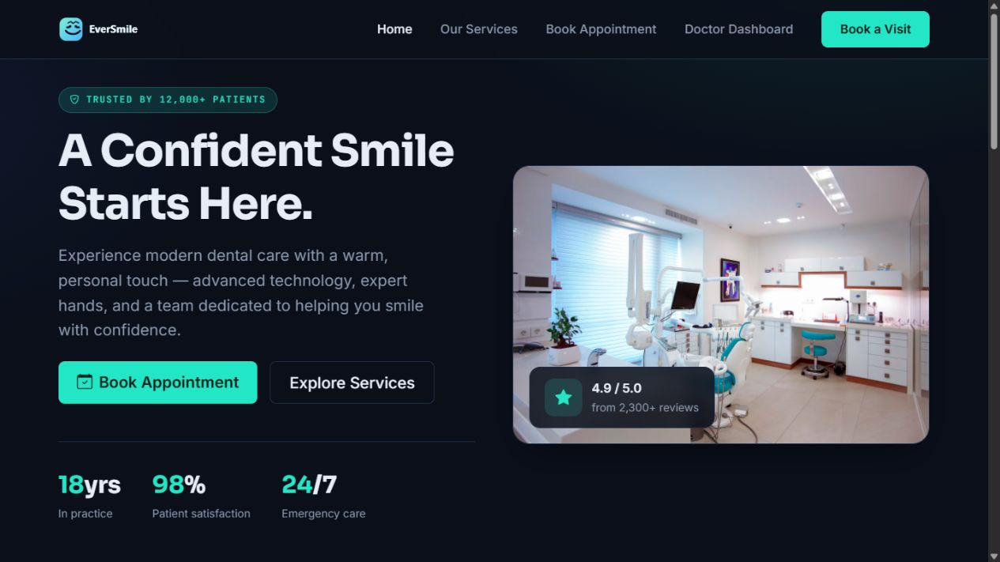

# EverSmile

**Dental clinic website and appointment-management demo — built by Kareem Wael.**

[**View the website →**](https://kareemw527-svg.github.io/EverSmile/) · [Contact Kareem](mailto:kareemw527@gmail.com)



A responsive full stack project connecting a dental services website, appointment booking flow, and doctor/assistant dashboards to a dependency-free Node.js API.

## Try the website

The public GitHub Pages version is an **interactive portfolio demonstration**. It uses fictional sample appointments and keeps demo changes in this browser tab's session storage. No clinic is contacted, no SMS is sent, and no real booking is made. Use fictional details when testing. Clinic statistics, reviews, and contact information are illustrative content.

- Explore the homepage and filter the services catalog.
- Select a treatment, date, and time in the booking flow.
- Try the doctor and assistant dashboards, including confirmation and cancellation.
- Inspect the source to see the full Node.js appointment API.

## Run the full Node.js version locally

Requires Node.js 22 or later:

```sh
npm start
```

Open `http://localhost:3000`. The local version uses the API and writes appointments to `node/data/appointments.json`. It does not use the hosted demo adapter.

```sh
npm run dev       # development server with automatic restart
npm test          # demo behavior checks
npm run data:reset
```

`data:reset` clears locally stored appointments.

## Features and implementation

| Area | Implementation |
| --- | --- |
| Frontend | HTML5, CSS3, JavaScript, Bootstrap 5 |
| Services | Category filters and responsive treatment cards |
| Booking | Service, date/time, patient details, and live summary |
| Dashboards | Appointment list, status changes, totals, activity, chart UI |
| Backend | Node.js HTTP server and JSON REST endpoints |
| Deployment | GitHub Actions → GitHub Pages static demo |

```text
public/                Website pages, styling, images, and browser scripts
  js/demo.js           Opt-in browser-only preview adapter
  js/demo-config.js    Disabled locally; enabled in the Pages artifact
node/                  Node.js server and local JSON persistence
  data/appointments.json
  scripts/reset-data.js
test/                  Demo API behavior tests
docs/images/           Project screenshot
.github/workflows/     Tests and automated website publication
```

The website loads Bootstrap, Bootstrap Icons, Chart.js, Google Fonts, and illustrative clinic photography from external services.

## API

- `GET /api/appointments`
- `POST /api/appointments`
- `PATCH /api/appointments/:id`
- `DELETE /api/appointments/:id`

See [the backend guide](node/README.md) for details.

## Project scope

This is a portfolio project, not a production medical system. The local backend does not provide authentication or production-grade patient-data protection. Keep it local and use test data; add authentication, server-side authorization, hardened validation, and an appropriate database before real clinic use.

## Developer

**Kareem Wael** · Full Stack Web Developer  
[GitHub](https://github.com/kareemw527-svg) · [Email](mailto:kareemw527@gmail.com)
